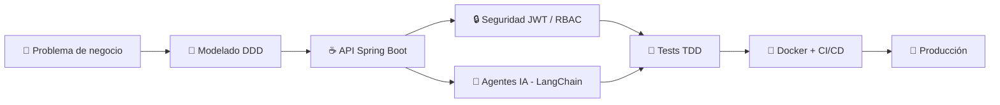

<!-- ═══════════════════════════ HEADER ═══════════════════════════ -->
<div align="center">


<a href="https://git.io/typing-svg">
  
</a>

<br/>

<a href="https://www.linkedin.com/in/sebasti%C3%A1n-salas-torres-317a4a425/"></a>
<a href="https://github.com/Jsebastiansalas"></a>
<a href="mailto:juansebastiansalas29@gmail.com"></a>


<br/>


<br/><br/>



</div>


<!-- ═══════════════════════════ RECRUITER TL;DR ═══════════════════════════ -->
## ⚡ Resumen para Reclutadores

<div align="center">

| 🎯 Rol | 🧰 Stack principal | 🏛️ Arquitectura | 🌎 Modalidad |
|:---:|:---:|:---:|:---:|
| **Backend & AI Engineer** | Java · Spring Boot · Python · LangChain | DDD · Clean Architecture · Microservicios | Remoto / Híbrido |

</div>

<details>
<summary><b>👉 ¿Por qué contratarme? (clic para ver)</b></summary>
<br/>

- ✅ **Entrego código listo para producción:** APIs REST seguras con JWT y RBAC, probadas con TDD y empaquetadas en Docker.
- ✅ **Uno backend e Inteligencia Artificial:** integro LLMs (Gemini y OpenAI) y agentes autónomos en sistemas empresariales reales.
- ✅ **Diseño pensando en el futuro:** separo dominio, aplicación e infraestructura para que el sistema crezca sin volverse inmanejable.
- ✅ **Hablo el idioma del negocio:** modelo los problemas con Domain-Driven Design antes de escribir una línea de código.

</details>


<!-- ═══════════════════════════ ABOUT ═══════════════════════════ -->
##  Sobre Mí

<table>
<tr>
<td width="60%">

```java
public class SebastianSalas extends SoftwareEngineer {

    private final String role     = "Backend & AI Engineer";
    private final String location = "Colombia 🇨🇴";

    private final String[] backend = {"Java 17+", "Spring Boot 3", "Spring Security"};
    private final String[] ai      = {"Python", "LangChain", "FastAPI", "LLMs"};
    private final String[] mindset = {"Clean Architecture", "DDD", "TDD", "Microservices"};

    public String mission() {
        return "Construir sistemas robustos, escalables e inteligentes "
             + "que generen impacto real en el negocio.";
    }
}
```

</td>
<td width="40%" align="center">
  
  <br/>
  <picture>
    <source media="(prefers-color-scheme: dark)" srcset="https://raw.githubusercontent.com/Jsebastiansalas/Jsebastiansalas/output/github-snake-dark.svg" />
    
  </picture>
</td>
</tr>
</table>

- 🔭 **Enfoque actual:** Arquitecturas backend de alto rendimiento con **Java & Spring Boot** y agentes autónomos con **Python & LangChain**.
- 🧠 **Pasión técnica:** Clean Architecture, Domain-Driven Design, microservicios e IA aplicada a decisiones empresariales.
- ✅ **Buenas prácticas:** TDD, pruebas unitarias e integración, Docker y diseño de APIs REST de nivel empresarial.
- ⚡ **Dato curioso:** Convierto problemas de negocio complejos en código limpio y mantenible.


<!-- ═══════════════════════════ VALUE ═══════════════════════════ -->
## 💎 Lo que Aporto a tu Equipo

<table>
  <tr>
    <td align="center" width="25%">
      <br/>
      <b>Backend Robusto</b><br/>
      <sub>APIs REST escalables con Spring Boot 3, seguridad JWT y persistencia optimizada.</sub>
    </td>
    <td align="center" width="25%">
      <br/>
      <b>IA Aplicada</b><br/>
      <sub>Agentes autónomos y pipelines con LangChain, Gemini y OpenAI que resuelven problemas reales.</sub>
    </td>
    <td align="center" width="25%">
      <br/>
      <b>Listo para Producción</b><br/>
      <sub>Contenedores multi-stage, CI con GitHub Actions y pruebas automatizadas.</sub>
    </td>
    <td align="center" width="25%">
      <br/>
      <b>Arquitectura Limpia</b><br/>
      <sub>DDD y Clean Architecture para código mantenible que escala con el negocio.</sub>
    </td>
  </tr>
</table>

### 🔄 Cómo construyo software




<!-- ═══════════════════════════ STACK ═══════════════════════════ -->
##  Stack Tecnológico

<div align="center">

### ☕ Backend


### 🤖 IA y Python


### 🐳 DevOps y Herramientas


<br/><br/>


</div>


<!-- ═══════════════════════════ PROJECTS ═══════════════════════════ -->
##  Proyectos Destacados

<table>
  <tr>
    <td width="50%" valign="top">
      <h3 align="center">📦 SupplyMind AI</h3>
      <p align="center"><i>Analista digital autónomo de disputas comerciales y arbitraje B2B</i></p>
      <p>Motor de razonamiento avanzado con <b>FastAPI</b>, backend desacoplado, interfaz reactiva <b>Obsidian Glass</b>, <b>Docker multi-stage</b> y suite de benchmarks con telemetría en tiempo real.</p>
      <p align="center">
        
        
        
        
      </p>
      <p align="center"><a href="https://github.com/Jsebastiansalas/SupplyMind-AI"></a></p>
    </td>
    <td width="50%" valign="top">
      <h3 align="center">🇨🇴 Ágora Colombia</h3>
      <p align="center"><i>Barómetro de percepción ciudadana con LLMs</i></p>
      <p>Arquitectura multi-frontend (FastAPI SPA + Streamlit) impulsada por <b>LangChain</b> y <b>Pydantic</b> para clasificación, auditoría y análisis estadístico en tiempo real con <b>Gemini y OpenAI</b>.</p>
      <p align="center">
        
        
        
        
      </p>
      <p align="center"><a href="https://github.com/Jsebastiansalas/Analisis-de-sentimientos-Langchain"></a></p>
    </td>
  </tr>
  <tr>
    <td width="50%" valign="top">
      <h3 align="center">🏛️ Bounded Contexts (DDD)</h3>
      <p align="center"><i>Domain-Driven Design y Arquitectura Limpia en Java</i></p>
      <p>Software empresarial desacoplado con contextos delimitados, separación estricta de dominio, aplicación e infraestructura, y persistencia relacional optimizada.</p>
      <p align="center">
        
        
        
        
      </p>
      <p align="center"><a href="https://github.com/Jsebastiansalas/bounded-contexts"></a></p>
    </td>
    <td width="50%" valign="top">
      <h3 align="center">🔒 Enterprise Spring Security</h3>
      <p align="center"><i>Autenticación y autorización robusta en Spring Boot</i></p>
      <p>Seguridad moderna con <b>JWT</b>, control de acceso basado en roles (RBAC), filtros personalizados y protección de endpoints críticos para APIs de producción.</p>
      <p align="center">
        
        
        
        
      </p>
      <p align="center"><a href="https://github.com/Jsebastiansalas/spring-security"></a></p>
    </td>
  </tr>
</table>


<!-- ═══════════════════════════ STATS ═══════════════════════════ -->
##  Actividad en GitHub

<div align="center">
  
</div>


<!-- ═══════════════════════════ FOOTER ═══════════════════════════ -->
<div align="center">

### 🤝 ¿Buscas un ingeniero backend con visión en IA? ¡Hablemos!

<a href="mailto:juansebastiansalas29@gmail.com">
  
</a>

<br/><br/>

<a href="https://www.linkedin.com/in/sebasti%C3%A1n-salas-torres-317a4a425/"></a>
<a href="mailto:juansebastiansalas29@gmail.com"></a>


</div>
