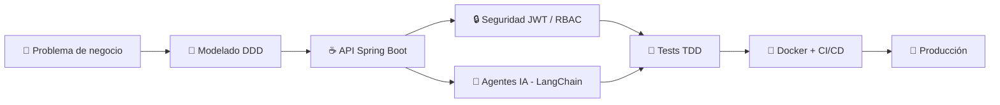

<!-- ═══════════════════════════ HEADER ═══════════════════════════ -->
<div align="center">


<a href="https://git.io/typing-svg">
  
</a>

<br/>

<a href="https://www.linkedin.com/in/sebasti%C3%A1n-salas-torres-317a4a425/"></a>
<a href="https://github.com/Jsebastiansalas"></a>
<a href="mailto:juansebastiansalas29@gmail.com"></a>


<br/>


<br/><br/>


</div>


<!-- ═══════════════════════════ RECRUITER TL;DR ═══════════════════════════ -->
## ⚡ Resumen para Reclutadores

<div align="center">

| 🎯 Rol | 🧰 Stack principal | 🎓 Formación | 🗣️ Idiomas | 🌎 Modalidad |
|:---:|:---:|:---:|:---:|:---:|
| **Full Stack Developer**<br/><sub>énfasis Backend Java & IA</sub> | Java · Spring Boot · Python<br/>JavaScript · MySQL · PostgreSQL | Técnico en Programación<br/>Avanzada de Software<br/><sub>Campuslands · 2026</sub> | Español (nativo)<br/>Inglés (A2, en mejora) | Remoto / Híbrido<br/><sub>Girón, Santander</sub> |

</div>

<details>
<summary><b>👉 ¿Por qué contratarme? (clic para ver)</b></summary>
<br/>

- ✅ **Construyo soluciones completas:** desde la interfaz (HTML5, CSS3, JavaScript) hasta el backend (Java, Spring Boot) y la base de datos (MySQL, PostgreSQL).
- ✅ **Sumo Inteligencia Artificial:** he integrado LLMs (Gemini y OpenAI) y agentes con LangChain en mis proyectos.
- ✅ **Trabajo en equipo con Scrum:** participo en la planificación de sprints, estimo tareas y gestiono el backlog en Jira.
- ✅ **Aplico buenas prácticas:** APIs REST seguras con JWT, Clean Architecture, DDD, pruebas y Docker.
- ✅ **Aprendo rápido y por mi cuenta:** soy responsable, disciplinado y autodidacta, y sigo mejorando mi inglés.

</details>


<!-- ═══════════════════════════ ABOUT ═══════════════════════════ -->
##  Sobre Mí

<table>
<tr>
<td width="60%">

```java
public class SebastianSalas extends SoftwareEngineer {

    private final String role      = "Full Stack Developer";
    private final String location  = "Girón, Santander 🇨🇴";
    private final String education = "Programación Avanzada de Software @ Campuslands";

    private final String[] frontend  = {"JavaScript", "HTML5", "CSS3"};
    private final String[] backend   = {"Java", "Spring Boot", "Spring Security"};
    private final String[] ai        = {"Python", "LangChain", "FastAPI", "LLMs"};
    private final String[] databases = {"MySQL", "PostgreSQL"};
    private final String[] workflow  = {"Scrum", "Jira", "Git", "GitHub"};
    private final String[] languages = {"Español (nativo)", "Inglés (A2)"};

    public String mission() {
        return "Construir soluciones completas, desde la interfaz "
             + "hasta el backend y la base de datos.";
    }
}
```

</td>
<td width="40%" align="center">
  
  <br/>
  <picture>
    <source media="(prefers-color-scheme: dark)" srcset="https://raw.githubusercontent.com/Jsebastiansalas/Jsebastiansalas/output/github-snake-dark.svg" />
    
  </picture>
</td>
</tr>
</table>

- 🎓 **Formación:** estudio el **Técnico en Programación Avanzada de Software** en **Campuslands** (2026, en curso).
- 🔭 **Enfoque actual:** backend con **Java & Spring Boot** y agentes de IA con **Python & LangChain**.
- 🛒 **Experiencia práctica:** proyectos académicos como un **e-commerce** y **sistemas de gestión**, además de proyectos personales con IA.
- 🤝 **Metodología:** trabajo con **Scrum** (sprints, estimación y backlog) usando **Jira**, **Git** y **GitHub**.
- 🌱 **Actitud:** responsable, disciplinado y autodidacta. Hoy mejoro mi inglés para seguir creciendo.


<!-- ═══════════════════════════ VALUE ═══════════════════════════ -->
## 💎 Lo que Aporto a tu Equipo

<table>
  <tr>
    <td align="center" width="25%">
      <br/>
      <b>Full Stack</b><br/>
      <sub>Interfaces web dinámicas con JavaScript, HTML5 y CSS3, conectadas a mi propio backend.</sub>
    </td>
    <td align="center" width="25%">
      <br/>
      <b>Backend Sólido</b><br/>
      <sub>APIs REST con Spring Boot, seguridad JWT y bases de datos MySQL y PostgreSQL.</sub>
    </td>
    <td align="center" width="25%">
      <br/>
      <b>IA Aplicada</b><br/>
      <sub>Agentes y análisis con LangChain, Gemini y OpenAI integrados en proyectos reales.</sub>
    </td>
    <td align="center" width="25%">
      <br/>
      <b>Trabajo Ágil</b><br/>
      <sub>Scrum, sprints, estimación de tareas y backlog en Jira. Control de versiones con Git.</sub>
    </td>
  </tr>
</table>

### 🔄 Cómo construyo software




<!-- ═══════════════════════════ STACK ═══════════════════════════ -->
##  Stack Tecnológico

<div align="center">

### ☕ Backend y Bases de Datos


### 🎨 Frontend


### 🤖 IA y Python


### 🐳 DevOps, Herramientas y Gestión


<br/><br/>


</div>


<!-- ═══════════════════════════ EDUCATION ═══════════════════════════ -->
## 🎓 Formación e Idiomas

<table>
  <tr>
    <td width="50%" valign="top">
      <h4>🚀 Técnico en Programación Avanzada de Software</h4>
      <b>Campuslands</b> · <i>2026 (en curso)</i><br/>
      <sub>Formación intensiva en desarrollo full stack: Java, Spring Boot, JavaScript, bases de datos relacionales y trabajo ágil con Scrum.</sub>
      <br/><br/>
      <h4>📘 Bachiller</h4>
      <b>Colegio Siglo XXI</b> · <i>2025</i>
    </td>
    <td width="50%" valign="top">
      <h4>🗣️ Idiomas</h4>
      🇪🇸 <b>Español</b> — Nativo<br/>
      
      <br/><br/>
      🇬🇧 <b>Inglés</b> — A2 (en mejora constante)<br/>
      
    </td>
  </tr>
</table>


<!-- ═══════════════════════════ PROJECTS ═══════════════════════════ -->
##  Proyectos Destacados

<table>
  <tr>
    <td width="50%" valign="top">
      <h3 align="center">📦 SupplyMind AI</h3>
      <p align="center"><i>Analista digital autónomo de disputas comerciales y arbitraje B2B</i></p>
      <p>Motor de razonamiento avanzado con <b>FastAPI</b>, backend desacoplado, interfaz reactiva <b>Obsidian Glass</b>, <b>Docker multi-stage</b> y suite de benchmarks con telemetría en tiempo real.</p>
      <p align="center">
        
        
        
        
      </p>
      <p align="center"><a href="https://github.com/Jsebastiansalas/SupplyMind-AI"></a></p>
    </td>
    <td width="50%" valign="top">
      <h3 align="center">🇨🇴 Ágora Colombia</h3>
      <p align="center"><i>Barómetro de percepción ciudadana con LLMs</i></p>
      <p>Arquitectura multi-frontend (FastAPI SPA + Streamlit) impulsada por <b>LangChain</b> y <b>Pydantic</b> para clasificación, auditoría y análisis estadístico en tiempo real con <b>Gemini y OpenAI</b>.</p>
      <p align="center">
        
        
        
        
      </p>
      <p align="center"><a href="https://github.com/Jsebastiansalas/Analisis-de-sentimientos-Langchain"></a></p>
    </td>
  </tr>
  <tr>
    <td width="50%" valign="top">
      <h3 align="center">🏛️ Bounded Contexts (DDD)</h3>
      <p align="center"><i>Domain-Driven Design y Arquitectura Limpia en Java</i></p>
      <p>Software empresarial desacoplado con contextos delimitados, separación estricta de dominio, aplicación e infraestructura, y persistencia relacional optimizada.</p>
      <p align="center">
        
        
        
        
      </p>
      <p align="center"><a href="https://github.com/Jsebastiansalas/bounded-contexts"></a></p>
    </td>
    <td width="50%" valign="top">
      <h3 align="center">🔒 Enterprise Spring Security</h3>
      <p align="center"><i>Autenticación y autorización robusta en Spring Boot</i></p>
      <p>Seguridad moderna con <b>JWT</b>, control de acceso basado en roles (RBAC), filtros personalizados y protección de endpoints críticos para APIs de producción.</p>
      <p align="center">
        
        
        
        
      </p>
      <p align="center"><a href="https://github.com/Jsebastiansalas/spring-security"></a></p>
    </td>
  </tr>
</table>


<!-- ═══════════════════════════ STATS ═══════════════════════════ -->
##  Actividad en GitHub

<div align="center">
  
</div>


<!-- ═══════════════════════════ FOOTER ═══════════════════════════ -->
<div align="center">

### 🤝 ¿Buscas un desarrollador full stack con ganas de crecer y visión en IA? ¡Hablemos!

<a href="mailto:juansebastiansalas29@gmail.com">
  
</a>

<br/><br/>

<a href="https://www.linkedin.com/in/sebasti%C3%A1n-salas-torres-317a4a425/"></a>
<a href="mailto:juansebastiansalas29@gmail.com"></a>


</div>
